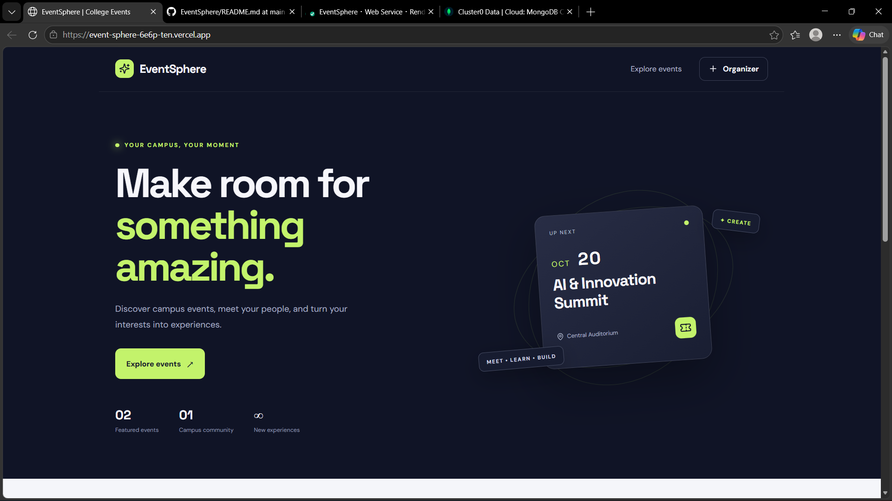

# EventSphere — College Event Management & Registration Platform

EventSphere is a web-based platform designed to make college event discovery and registration easier. Users can browse events, register for events, and view registration status. Event data is stored in MongoDB Atlas.

## 🌐 Live Demo

- **Website:** https://event-sphere-6e6p-ten.vercel.app/
- **Backend API:** https://eventsphere-gkls.onrender.com

## ✨ Features

- Browse available college events
- Register for events
- Prevent duplicate registrations
- View registration status
- Create and manage events through the event form
- Store event and registration data in MongoDB
- Responsive interface for desktop and mobile devices
  ## Project Screenshot




## 🛠️ Tech Stack

- **Frontend:** React, Vite, JavaScript, CSS
- **Backend:** Node.js, Express.js
- **Database:** MongoDB Atlas
- **Deployment:** Vercel and Render
- **Version Control:** Git and GitHub

## 📁 Project Structure

```text
EventSphere/
├── client/       # React frontend
├── server/       # Express backend and API
├── .gitignore
└── README.md
```

## 🚀 Run Locally

### Prerequisites

- Node.js and npm
- MongoDB Atlas account or local MongoDB
- Git

### 1. Start the backend

```bash
cd server
npm install
```

Create a local `.env` file using `.env.example` as a reference. Configure `PORT`, `MONGODB_URI`, and `CLIENT_ORIGIN` with your local settings.

Then start the backend using the script configured in `server/package.json`, for example:

```bash
npm start
```

### 2. Start the frontend

Open a second terminal:

```bash
cd client
npm install
npm run dev
```

Open the local URL shown by Vite, usually `http://localhost:5173`.

Configure the frontend API URL to point to your backend. For local development, it is usually `http://localhost:5000/api`.

## ☁️ Deployment

- **Frontend:** Vercel
- **Backend:** Render
- **Database:** MongoDB Atlas

Configure deployment environment variables in the relevant hosting dashboards. Never commit real passwords, database connection strings, or other secrets to GitHub.

## 🔐 Security Notes

This project is an academic demonstration. Before using it for real events, implement secure administrator authentication, server-side validation, rate limiting, and appropriate access controls.

## 👩‍💻 Author

**K. Rishitha**

GitHub: [@rishithak0416](https://github.com/rishithak0416)

---

*Built as a college project to practise full-stack web development and database integration.*

## Important
This is an academic demo starter, not a production-ready ticketing system. Add proper admin authentication, validation, rate limiting and access controls before real-world use.
